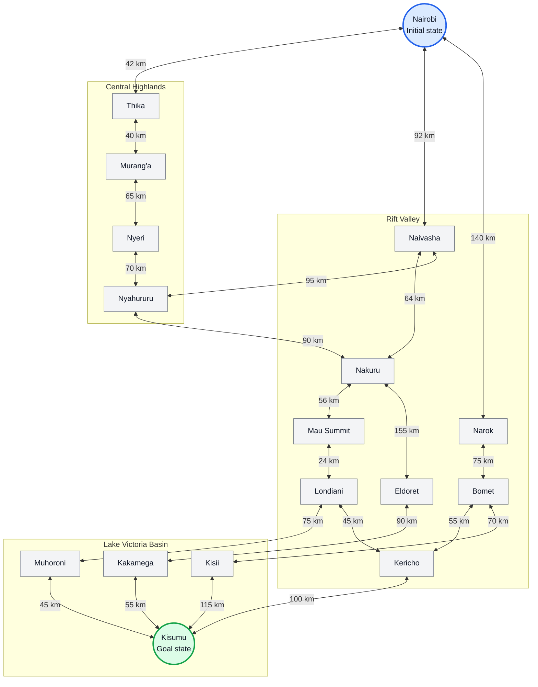
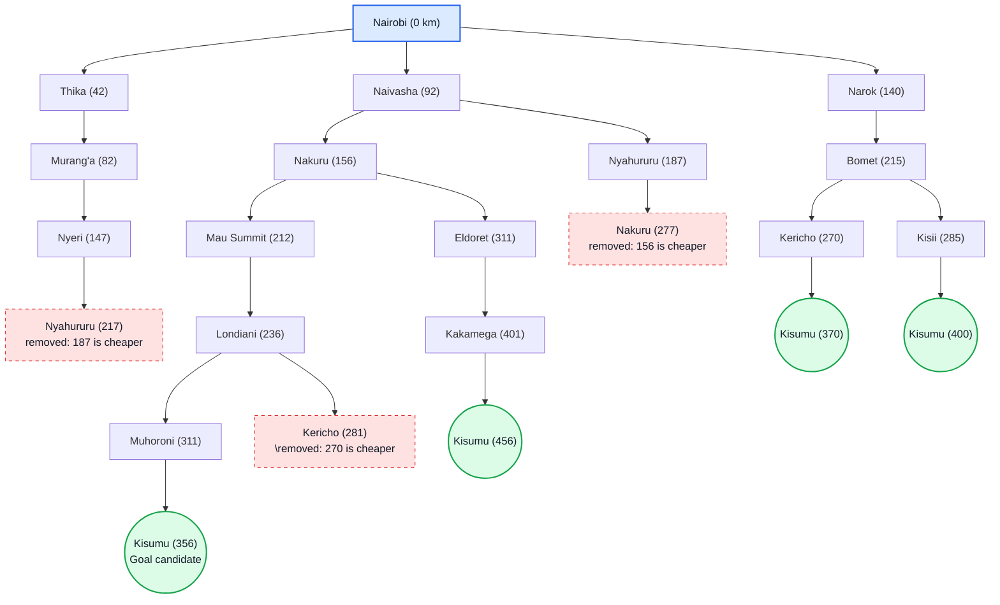

# Group Assignment

## Question 1: Design the agent using the PEAS framework and classify its environment

Based on the PEAS framework for a self-driving car, the following design is proposed for a self-driving trailer travelling on Kenya's highway network.

### 1.1 PEAS framework

| Component | Self-driving trailer |
|---|---|
| **P: Performance measure** | Minimize total distance and travel time; avoid collisions; obey traffic laws; deliver cargo safely; and minimize fuel consumption. |
| **E: Environment** | Kenyan highways and roads, towns, cities, other vehicles, pedestrians, roadworks, weather, traffic, road signs, and destinations. |
| **A: Actuators** | Steering, accelerator, brakes, gear controls, indicators, horn, and trailer braking system. |
| **S: Sensors** | GPS, cameras, radar, LiDAR, speedometer, wheel sensors, fuel sensors, and engine sensors. |

### 1.2 Classification of the agent environment

| Environment property | Classification | Explanation |
|---|---|---|
| Observability | **Partially observable** | Sensors cannot reveal every road hazard, hidden obstacle, or future traffic condition. |
| Determinism | **Stochastic** | Traffic, weather, accidents, and other road users make outcomes uncertain. |
| Episodic or sequential | **Sequential** | Each driving decision affects the trailer's later position, route, and travel cost. |
| Static or dynamic | **Dynamic** | Traffic, weather, and road conditions can change while the trailer is moving. |
| Number of agents | **Multi-agent** | Other drivers, pedestrians, and road users also affect the environment. |

## Question 2: Directed graph and search tree

### 2.1 Problem formulation

The self-driving trailer's route-planning task can be formulated as a search problem.

| Element | Definition |
|---|---|
| **State** | The town or city where the trailer is currently located. |
| **Initial state** | Nairobi. |
| **Goal test** | The current town is Kisumu. |
| **Actions** | Travel along a road connection to an adjacent town. |
| **Path cost** | The sum of the road distances travelled, measured in kilometres. |
| **Abstraction** | Represent the road network using selected major towns and omit minor junctions, lane choices, traffic details, fuel use, gradients, and road-surface details from the basic distance calculation. |

### 2.2 Directed highway graph

The graph represents selected towns in the Nairobi, Central Highlands, Rift Valley, and Lake Victoria Basin regions. Each node represents a town or city, each edge represents a road connection, and the edge label gives the assumed distance in kilometres.

### 2.3 Abstraction hierarchy

Abstraction reduces a complex real-world road network to the information needed for route planning. Rather than representing every junction and road segment, this model represents major towns and the connections between them.

#### Level 1: Regional abstraction

At the regional level, the agent reasons about movement between broad regions.

#### Level 2: Town-level refinement

At the refined level, each regional connection is represented by individual towns and road distances. For example:

### 2.4 Search tree for uniform-cost search

Uniform-cost search (UCS) expands the frontier node with the lowest cumulative path cost, denoted by `g(n)`. It does not simply choose the geographically closest-looking town; it chooses the lowest accumulated distance from Nairobi.

**How to interpret the tree:**

- The number in parentheses is the cumulative distance from Nairobi, in kilometres.
- Nyahururu at 217 km is rejected because it was already reached at 187 km.
- Nakuru at 277 km is rejected because Nakuru was already reached at 156 km.
- Kericho at 281 km is rejected because Kericho was already reached at 270 km.
- The route to Kisumu through Muhoroni costs 356 km, less than the other listed complete routes.

A town may appear more than once in a search tree because different paths can reach the same town. In graph search, the agent tracks the best known cost to each state to avoid needlessly expanding more expensive duplicate paths.

### 2.5 Uniform-cost search expansion order

UCS selects the frontier node with the lowest cumulative cost.

| Step | Node expanded | `g(n)` (km) | Important frontier update |
|---:|---|---:|---|
| 1 | Nairobi | 0 | Add Thika (42), Naivasha (92), Narok (140). |
| 2 | Thika | 42 | Add Murang'a (82). |
| 3 | Murang'a | 82 | Add Nyeri (147). |
| 4 | Naivasha | 92 | Add Nakuru (156) and Nyahururu (187). |
| 5 | Narok | 140 | Add Bomet (215). |
| 6 | Nyeri | 147 | Nyahururu at 217 km is rejected because it is already reachable at 187 km. |
| 7 | Nakuru | 156 | Add Mau Summit (212) and Eldoret (311). |
| 8 | Nyahururu | 187 | Nakuru at 277 km is rejected because Nakuru is already reachable at 156 km. |
| 9 | Mau Summit | 212 | Add Londiani (236). |
| 10 | Bomet | 215 | Add Kericho (270) and Kisii (285). |
| 11 | Londiani | 236 | Add Muhoroni (311); Kericho at 281 km is rejected because 270 km is cheaper. |
| 12 | Kericho | 270 | Add Kisumu (370). |
| 13 | Kisii | 285 | Kisumu at 400 km is rejected because a 370 km route is already known. |
| 14 | Eldoret | 311 | Add Kakamega (401). Muhoroni at 311 km remains in the frontier. |
| 15 | Muhoroni | 311 | Add Kisumu (356), improving the existing 370 km route. |
| 16 | Kisumu | 356 | The lowest-cost goal is removed from the frontier; the goal test succeeds. |

The route is optimal within this graph because UCS removes Kisumu from the frontier at a cumulative cost of 356 km, and all edge costs are non-negative. The conclusion applies to the constructed graph and the distances used in it.

---

## Question 3: Determine the optimal path from Nairobi to Kisumu

### 3.1 Path cost function

The path cost is the sum of the distances for all road segments in a route.
The objective is to minimize total distance. 

### 3.2 Calculate the selected route

**Nairobi → Naivasha → Nakuru → Mau Summit → Londiani → Muhoroni → Kisumu**

| Road segment | Distance (km) | Cumulative cost (km) |
|---|---:|---:|
| Nairobi → Naivasha | 92 | 92 |
| Naivasha → Nakuru | 64 | 156 |
| Nakuru → Mau Summit | 56 | 212 |
| Mau Summit → Londiani | 24 | 236 |
| Londiani → Muhoroni | 75 | 311 |
| Muhoroni → Kisumu | 45 | 356 |
| **Total** | **356** | **356** |

\[
92 + 64 + 56 + 24 + 75 + 45 = {356km}
\]

### 3.3 Compare the other complete routes

| Alternative route | Total distance |
|---|---:|
| Nairobi → Naivasha → Nakuru → Mau Summit → Londiani → Muhoroni → Kisumu | **356 km** |
| Nairobi → Narok → Bomet → Kericho → Kisumu | 370 km |
| Nairobi → Narok → Bomet → Kisii → Kisumu | 400 km |
| Nairobi → Naivasha → Nakuru → Eldoret → Kakamega → Kisumu | 456 km |

